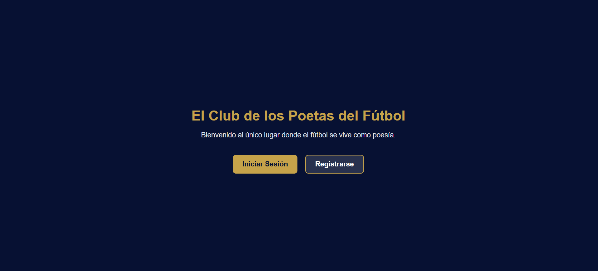
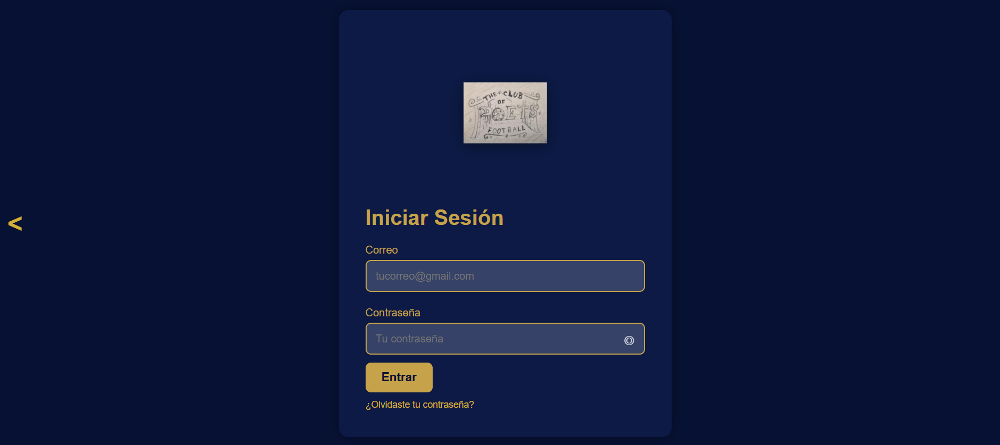
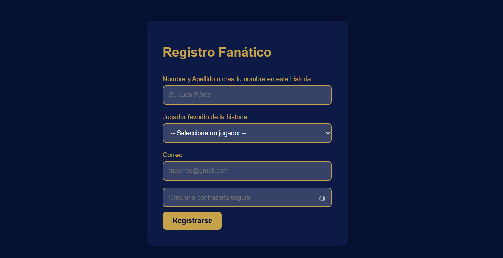
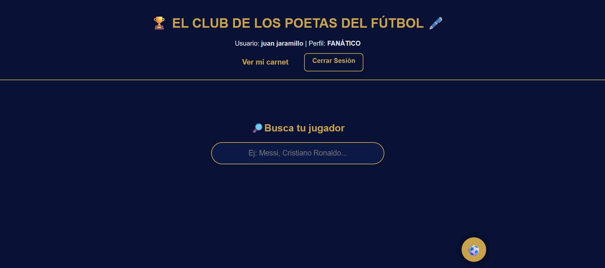
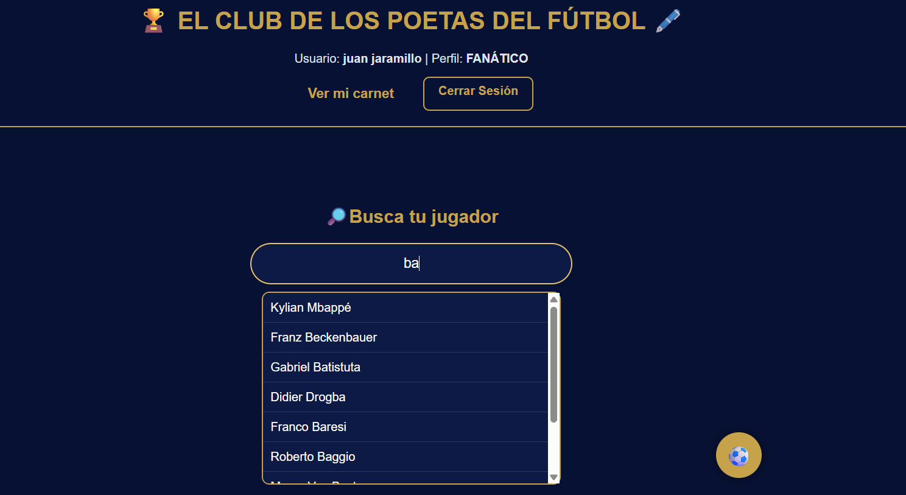
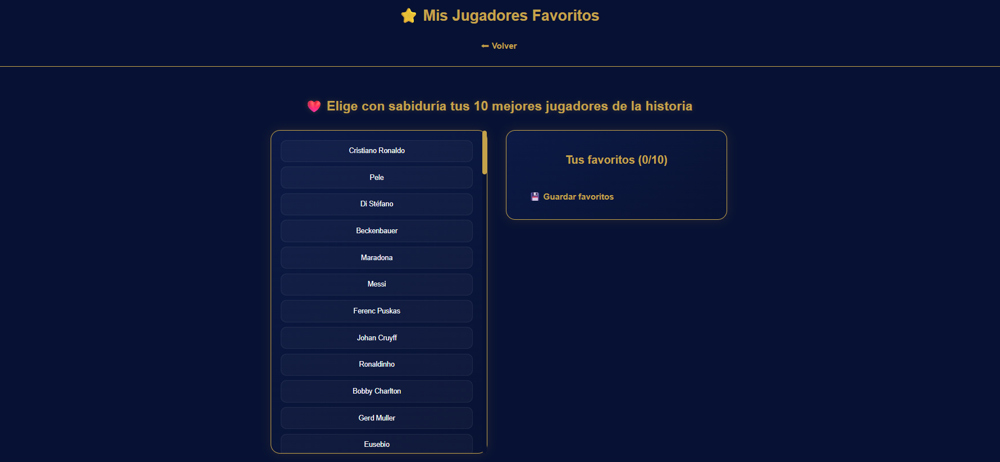
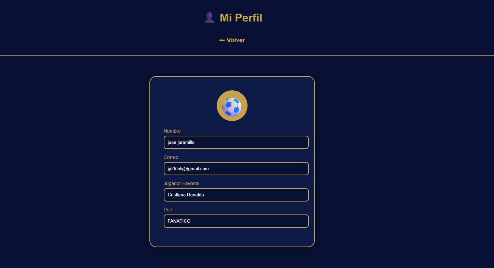

# ⚽ El Club de los Poetas del Fútbol (CPF)

## Descripción del Proyecto

**El Club de los Poetas del Fútbol (CPE)** Es una plataforma web desarrollada como proyecto productivo del programa **Análisis y Desarrollo de Software (ADSO)** del **Servicio Nacional de Aprendizaje (SENA)**.

La aplicación permite a los usuarios registrarse, iniciar sesión, consultar información de jugadores y administrar una lista personalizada de jugadores favoritos mediante una interfaz moderna, intuitiva y responsiva.

El proyecto fue desarrollado utilizando tecnologías web como **HTML5, CSS3, JavaScript, PHP y MySQL**, siguiendo buenas prácticas de desarrollo de software y documentación técnica.

> **Nota:** Las funcionalidades relacionadas con comunidad, publicaciones, gamificación y sistema de puntajes se encuentran planteadas como mejoras futuras y no hacen parte de la versión actual del sistema.

---

# Objetivos

### Objetivo General

Desarrollar una plataforma web que permita consultar información de jugadores de fútbol y administrar jugadores favoritos mediante una interfaz intuitiva, segura y fácil de utilizar.

### Objetivos Específicos

- Registrar usuarios dentro del sistema.
- Permitir el inicio y cierre de sesión.
- Consultar información de jugadores.
- Gestionar jugadores favoritos.
- Brindar una experiencia de usuario clara y sencilla.
- Facilitar futuras ampliaciones del proyecto.

---

# Funcionalidades

- ✅ Registro de usuarios.
- ✅ Inicio de sesión.
- ✅ Recuperación de contraseña.
- ✅ Consulta de jugadores.
- ✅ Gestión de jugadores favoritos.
- ✅ Perfil de usuario.
- ✅ Cierre de sesión.

- # 🛠️ Tecnologías Utilizadas

## Frontend

- HTML5
- CSS3
- JavaScript

## Backend

- PHP

## Base de Datos

- MySQL

## Servidor Local

- XAMPP

## Control de Versiones

- Git
- GitHub

---

# 📁 Arquitectura del Proyecto

El proyecto está organizado bajo una arquitectura cliente-servidor, separando el frontend, el backend y los recursos estáticos para facilitar el mantenimiento y la escalabilidad de la aplicación.

---

# 📂 Estructura del Proyecto

```text
club-poetas/
│
├── backend/
│   ├── conexion.php
│   ├── login.php
│   ├── logout.php
│   ├── buscar.php
│   ├── jugadores.php
│   ├── obtener_favoritos.php
│   ├── registrar_usuario.php
│   ├── proteger.php
│   └── numeros_jugadores.php
│
├── frontend/
│   ├── css/
│   ├── js/
│   ├── img/
│   ├── index.html
│   ├── login.html
│   ├── dashboard.php
│   ├── perfil.php
│   ├── favoritos.php
│   ├── carnet.php
│   ├── elegir-perfil.html
│   ├── forgot_password.php
│   ├── guardar_favoritos.php
│   ├── jugador.php
│   ├── nosotro.php
│   ├── registro.html
│   ├── reset_password.php
│   ├── send_reset.php
│   ├── sidebar_ads.php
│   ├── update_password.php
│  

└── README.md
```

## Base de Datos

El script de la base de datos se encuentra en la carpeta:

```text
database/club_poetas.sql
```

Este archivo contiene la estructura de la base de datos utilizada por el proyecto, incluyendo las tablas necesarias para el funcionamiento del sistema.

Para importar la base de datos:

1. Abrir **phpMyAdmin**.
2. Crear una base de datos llamada **club_poetas**.
3. Seleccionar la opción **Importar**.
4. Elegir el archivo `club_poetas.sql`.
5. Ejecutar la importación.

---

# 💻 Requisitos del Sistema

Para ejecutar el proyecto de forma local se requiere:

- XAMPP.
- PHP 8 o superior.
- MySQL.
- Navegador web moderno (Google Chrome, Microsoft Edge o Mozilla Firefox).
- Git (opcional para clonar el repositorio).

---
- ✅ Diseño Responsive.

---

# 🚀 Instalación y Ejecución

Para ejecutar el proyecto de forma local siga los siguientes pasos:

## 1. Clonar el repositorio

```bash
git clone https://github.com/TU-USUARIO/club-poetas.git
```

> Si descargó el proyecto en formato ZIP, descomprímalo en la carpeta **htdocs** de XAMPP.

---

## 2. Copiar el proyecto

Ubique la carpeta del proyecto dentro de:

```
C:\xampp\htdocs\
```

---

## 3. Iniciar XAMPP

Abra el panel de control de XAMPP e inicie los servicios:

- Apache
- MySQL

---

## 4. Crear la Base de Datos

Abra **phpMyAdmin** y cree una nueva base de datos.

Posteriormente importe el archivo SQL incluido en el proyecto.

---

## 5. Ejecutar el proyecto

Desde el navegador acceda a:

```
http://localhost/club-poetas/frontend/index.html
```

> Si la carpeta del proyecto tiene un nombre diferente, reemplácelo en la URL.

---

# 🗄️ Base de Datos

El sistema utiliza **MySQL** como gestor de base de datos.

### Tablas implementadas

- usuarios
- favoritos

La estructura de la base de datos se encuentra incluida mediante el script SQL del proyecto.

---

# 🔐 Usuarios de Prueba

Para realizar pruebas del sistema puede registrar un nuevo usuario desde la interfaz de registro.

---

# 📸 Capturas del Sistema

A continuación se presentan algunas de las principales interfaces desarrolladas para la plataforma.

## Página de Inicio



---

## Inicio de Sesión



---

## Registro de Usuario



---

## Dashboard



---

## Consulta de Jugadores



---

## Jugadores Favoritos



---

## Perfil de Usuario



---

# 📂 Estructura General del Proyecto

```
club-poetas
│
├── backend/
│   ├── conexion.php
│   ├── login.php
│   ├── logout.php
│   ├── buscar.php
│   ├── jugadores.php
│   ├── obtener_favoritos.php
│   ├── registrar_usuario.php
│   ├── proteger.php
│   └── numeros_jugadores.php
│
├── frontend
│   ├── css
│   ├── img
│   ├── js
│   ├── index.html
│   ├── login.html
│   ├── dashboard.php
│   ├── perfil.php
│   ├── favoritos.php
│   ├── carnet.php
│   ├── elegir-perfil.html
│   ├── forgot_password.php
│   ├── guardar_favoritos.php
│   ├── jugador.php
│   ├── nosotro.php
│   ├── registro.html
│   ├── reset_password.php
│   ├── send_reset.php
│   ├── sidebar_ads.php
│   ├── update_password.php
│  
│
└── README.md
```

---

# 🔮 Mejoras Futuras

Las siguientes funcionalidades han sido planteadas para futuras versiones del proyecto:

- Sistema de comunidad entre usuarios.
- Publicaciones relacionadas con el fútbol.
- Sistema de gamificación y puntajes.
- Insignias y logros para usuarios.
- Mayor cantidad de estadísticas deportivas.
- Optimización del rendimiento y nuevas funcionalidades.

---

# 👨‍💻 Autor

**Juan Pablo Jara,illo Rodríguez**

Aprendiz del programa **Análisis y Desarrollo de Software (ADSO)** del **Servicio Nacional de Aprendizaje (SENA)**.

Proyecto desarrollado como parte de la etapa productiva bajo la modalidad de **Proyecto Productivo**, aplicando los conocimientos adquiridos durante el proceso de formación.

---

# 📄 Licencia

Este proyecto fue desarrollado con fines académicos como requisito para optar por la certificación del programa ADSO del SENA.

El código fuente y el diseño del proyecto pertenecen a su autor. Su uso con fines educativos está permitido siempre que se reconozca la autoría correspondiente.

---

# © Derechos de Autor

© 2026 Juan Pablo Jara Rodríguez.

Todos los derechos reservados.

---

# ⭐ Estado del Proyecto

**Versión:** 1.0

**Estado:** Finalizado para entrega académica.

El proyecto podrá continuar evolucionando con nuevas funcionalidades y mejoras en futuras versiones.
